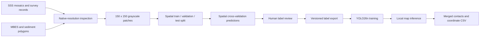

# SSS-detector

A local research toolkit for detecting and reviewing seabed contacts in side-scan sonar (SSS) imagery.

The project connects native-resolution survey inspection, spatial dataset preparation, human review of model-suggested label errors, single-channel YOLO26 training, and georeferenced map inference. The current training data comes from **Costa Head CES-86**. Moray Firth and other surveys are used in separate inspection or exploratory workflows.

**Status, 9 October 2026:** the local workflow is implemented, a trained checkpoint is available locally, and saved inference results cover up to a 2 km × 2 km region. Independent test-label review and a controlled comparison of model versions remain open. This repository records the implementation and evidence; a fresh clone requires the separately stored data and weights to run the full workflow.

## Workflow



The model predicts one class, `contact`: a visible sonar target. The labels do not establish an object's physical identity or whether it is unexploded ordnance.

## Components

| Directory | Role |
|---|---|
| [`sss_contact_inspector/`](sss_contact_inspector/README.md) | Costa Head and Moray Firth contact maps, native image crops, dataset export and data-quality inspection. |
| [`sss_mbes_sediment_viewer/`](sss_mbes_sediment_viewer/README.md) | Co-registered SSS, MBES elevation, geometric roughness and official sediment polygons. |
| [`sss_contact_yolo26/`](sss_contact_yolo26/README.md) | Two review rounds, retraining scripts, the inference application and regional experiments. |
| [`notebooks/`](notebooks/README.md) | English, output-free copies of the current training and spatial-CV notebooks. |
| `sss_contact_yolov8_spatial_split_bundle/` | Dataset configuration and helper code for the spatial split; images and labels remain local. |
| `sss_contact_yolov8_colab_bundle/`, `sss_contact_l4_colab_bundle/` | Earlier YOLOv8 training and zero-shot comparison helpers. These are historical experiments. |
| `sas_native_viewer/` | An exploratory viewer for a separate 3 cm Galapagos SAS raster. |
| `tools/` | Earlier raster preparation and visualization utilities. |

Existing directory names are retained so local data and scripts keep their current relative locations. The repository name is `SSS-detector`; an existing checkout may still be named `IRP-external`.

## Current dataset and results

- **10,756 patches**, each 150 × 150 pixels, grayscale, at 0.1 m/pixel.
- **100-pixel stride**, producing 50-pixel overlap between adjacent patches.
- Spatial split: **6,847 train / 1,696 validation / 1,605 test / 608 buffer** patches. Cross-split buffers provide a 15 m separation. Annotation group numbers are not geographic order.
- Two review rounds covered **9,000 patches in spatial chunks 1–9**. Annotation boxes increased from **907 → 2,004 → 2,992**. Overlapping patches may contain the same physical target.

Metrics stored in the current `yolo26n_A_round2_v001/best.pt` checkpoint:

| Validation metric | Value |
|---|---:|
| Precision | 0.63557 |
| Recall | 0.68011 |
| mAP50 | 0.66530 |
| mAP50–95 | 0.38652 |

The checkpoint was trained on 23 September 2026 with Ultralytics 8.4.160, one input channel and `imgsz=256`. These are validation metrics against the round-2 labels, not an independently audited test result. The earlier 0.597 mAP50 result used different validation labels, so it does not establish the size of a model improvement.

Saved runs inspected on 9 October 2026:

| Input | Patches inferred | Elapsed run time | Merged predictions at confidence 0.5 |
|---|---:|---:|---:|
| Held-out spatial chunks 10–11 | 1,605 | 19 s | 236 |
| Separate 0.5 m survey image resampled to 0.1 m | 10,000 | 1 min 49 s | 211 |
| 2 km × 2 km Costa Head region outside the bundle | 40,000 | 7 min 40 s | 5,912 |

Counts were checked against both the saved run manifests and contact CSVs. They are predicted contacts, not verified detections. Resampling the 0.5 m image changes its pixel spacing but does not recover 0.1 m sensor detail. See [results and limitations](docs/RESULTS.md) for the evidence and outstanding evaluation work.

## Local inference application

The application supports the built-in test region, uploaded GeoTIFF/PNG images, patch folders, and compatible single-channel detection weights. It cuts large images into patches, displays progress, merges overlapping detections, and exports a full-resolution mosaic and a contact CSV. Georeferenced inputs retain map coordinates.

Application interfaces, runtime messages, review status labels and notebook generators use English. Previously saved upload metadata is also displayed in English.

With the existing local environment, data and checkpoint available, run from the repository root:

```sh
cd sss_contact_yolo26/apps/sss_contact_yolo26_test_inference_map
.venv/bin/python serve_map.py
```

Open `http://127.0.0.1:8770/`. See [running and restoring local assets](docs/RUNNING.md) and the [application README](sss_contact_yolo26/apps/sss_contact_yolo26_test_inference_map/README.md).

The current image input requires 8-bit grayscale at 0.1 m/pixel. The backend still holds full image arrays during some operations, even though the browser displays map tiles. Larger regions therefore remain limited by server memory.

## Validation status

Existing tests were run locally on 9 October 2026:

| Suite | Result |
|---|---:|
| SSS contact inspector | 8 passed, 2 failed |
| SSS / MBES / sediment viewer | 16 passed |
| Round-1 review platform | 13 passed |
| Round-2 review platform | 13 passed |

The inspector failures are recorded: the current contact file contains **20,985** records after two GIS contacts were added, while its test and preparation metadata still expect **20,983**; original survey ZIPs are unavailable at their recorded external-drive paths. This initial repository import does not repair either issue. These 52 tests cover the existing inspection and review suites, not a complete browser or inference application test suite.

## Repository contents

Tracked files contain application code, preprocessing helpers, tests, English documentation, output-free notebook copies and a small aggregate evidence record. Raw survey archives, rasters, patches, annotations, weights, generated results, third-party ECW source/build trees and local environments stay outside Git. Agent instructions, configurations, handoffs and logs are also ignored.

Source data and the trained checkpoint must be obtained or restored separately. A data and model distribution package and a public release license have not been selected. No training jobs, downloads, scheduled tasks or CI workflows are enabled by this repository import.

## Next work

1. Define a stable contact annotation guide, including ambiguous targets.
2. Review an independent test sample and report precision/recall with uncertainty.
3. Evaluate the earlier and current models against the same reviewed validation labels.
4. Reconcile inspector contact metadata and restore configurable source paths.
5. Package the applications with documented dependencies and reproducible setup.
