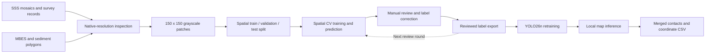

# SSS-detector

A research toolkit for detecting and reviewing seabed contacts in side-scan sonar imagery. It combines native-resolution survey inspection, spatial dataset preparation, human label review, YOLO26 training and georeferenced map inference.

- Inspect Costa Head and Moray Firth sonar imagery alongside survey contacts, bathymetry and sediment maps.
- Review spatial cross-validation predictions, edit annotations and export versioned labels.
- Run single-channel YOLO26 inference on sonar images or patch folders, inspect detections on a map and export contact coordinates.

## Demo

Run inference, explore detections on the map, and inspect individual sonar patches.

https://github.com/user-attachments/assets/6824c7f0-c12c-43b4-ad67-045ce871e99a

*Imagery: [Costa Head CES-86 (2012–2013)](https://www.marinedataexchange.co.uk/details/CES-86/2012-2013-osiris-projects-costa-head-osiris-geophysical-survey), Marine Data Exchange, hosted by Crown Estate Scotland. Survey by Osiris Projects for SSE Renewables / Costa Head Wave Farm Ltd. © Crown Copyright (2013).*

## Workflow



The detector uses one class, `contact`, for visible sonar targets such as boulders and debris.

## Model-assisted annotation and retraining

I used **model-assisted labeling with manual review** to recover contacts missing from the original annotations and improve the labels used for training.

1. **Train with the initial labels.** Single-channel YOLO26n models were trained on the existing contact annotations using spatial cross-validation.
2. **Predict held-out regions.** Each fold generated out-of-fold (OOF) detections for spatial blocks excluded from that fold's training set. Predictions unmatched to existing labels became candidates for manual review.
3. **Manually verify and supplement the labels.** I inspected the candidate contacts against the sonar imagery, confirmed real targets, corrected bounding boxes where needed, and rejected false detections. Confirmed missing contacts were added to the YOLO annotations alongside the existing labels.
4. **Export, retrain and repeat.** The reviewed labels were exported as a new annotation version. First-round labels were used to train models for a second prediction and review round. Second-round labels were then used to retrain the final YOLO26n detector with the spatial train/validation split preserved.

I completed two manual review rounds covering **9,000 patches** in spatial chunks 1–9. The annotation set grew from **907 → 2,004 → 2,992 bounding boxes**. The added labels were manually reviewed and confirmed before retraining. See [annotation versions](docs/RESULTS.md#annotation-versions) for the label exports and counts.

## Components

| Directory | Role |
|---|---|
| [`sss_contact_inspector/`](sss_contact_inspector/README.md) | Contact maps, native image crops, dataset export and data-quality inspection. |
| [`sss_mbes_sediment_viewer/`](sss_mbes_sediment_viewer/README.md) | Co-registered SSS, MBES elevation, geometric roughness and sediment polygons. |
| [`sss_contact_yolo26/`](sss_contact_yolo26/README.md) | Two review rounds, retraining scripts, regional experiments and the inference application. |
| [`notebooks/`](notebooks/README.md) | Colab training and spatial-CV templates. |
| `sss_contact_yolov8_spatial_split_bundle/` | Spatial-split configuration and dataset helpers. |
| `sss_contact_yolov8_colab_bundle/`, `sss_contact_l4_colab_bundle/` | Earlier YOLOv8 training and zero-shot comparison workflows. |
| `sas_native_viewer/` | Native-pixel viewer for a 3 cm Galapagos SAS raster. |
| `tools/` | Raster preparation and visualization utilities. |

## Dataset and results

The YOLO26 detector was trained on **Costa Head CES-86** imagery:

- **10,756 grayscale patches**, each 150 × 150 pixels at 0.1 m/pixel.
- **100-pixel stride**, with 50-pixel overlap between adjacent patches.
- **6,847 training / 1,696 validation / 1,605 test / 608 buffer** patches, split geographically with a 15 m cross-split buffer.

YOLO26n validation on spatial chunks 8–9, using the round-2 annotations:

| Metric | Value |
|---|---:|
| Precision | 0.63557 |
| Recall | 0.68011 |
| mAP50 | 0.66530 |
| mAP50–95 | 0.38652 |

The checkpoint was trained on 23 September 2026 with Ultralytics 8.4.160, one grayscale input channel and `imgsz=256`.

Recorded CPU inference runs from 23 September 2026:

| Input | Patches | Run time | Merged predictions at confidence 0.5 |
|---|---:|---:|---:|
| Test chunks 10–11 | 1,605 | 19 s | 236 |
| Separate survey image: 0.5 m native resolution, resampled to 0.1 m | 10,000 | 1 min 49 s | 211 |
| 2 km × 2 km Costa Head region outside the dataset bundle | 40,000 | 7 min 40 s | 5,912 |

See [experiments and results](docs/RESULTS.md) for data sources, annotation versions and evaluation details.

## Run the inference map

The application accepts 8-bit grayscale GeoTIFF or PNG images at 0.1 m/pixel, patch folders and single-channel detection weights. It provides live progress, map inspection, adjustable confidence thresholds, merged detections and coordinate exports. Interfaces and runtime messages use English.

Prepare the data, checkpoint and Python environment using [the setup guide](docs/RUNNING.md), then run from the repository root:

```sh
cd sss_contact_yolo26/apps/sss_contact_yolo26_test_inference_map
.venv/bin/python serve_map.py
```

Open `http://127.0.0.1:8770/`. The [application guide](sss_contact_yolo26/apps/sss_contact_yolo26_test_inference_map/README.md) covers input formats, map controls and output files.

## Data and development

This repository contains source code, tests, documentation, notebook templates and aggregate experiment records. Obtain survey data directly from the Marine Data Exchange and keep data, annotations, checkpoints and generated outputs in the local asset directories listed in [the setup guide](docs/RUNNING.md).

[Test results](docs/RUNNING.md#test-results) document the 9 October 2026 checks and the two outstanding inspector issues.

Next steps:

1. Write a contact annotation guide, including ambiguous targets.
2. Review an independent test sample and report precision and recall with confidence intervals.
3. Compare model versions on a shared set of validation annotations.
4. Update inspector contact metadata and make source paths configurable.
5. Package the applications and their dependencies.
